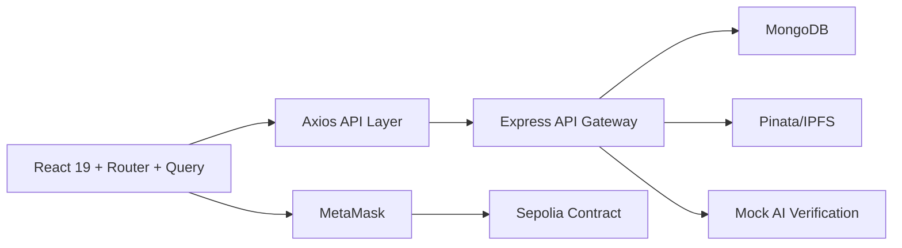
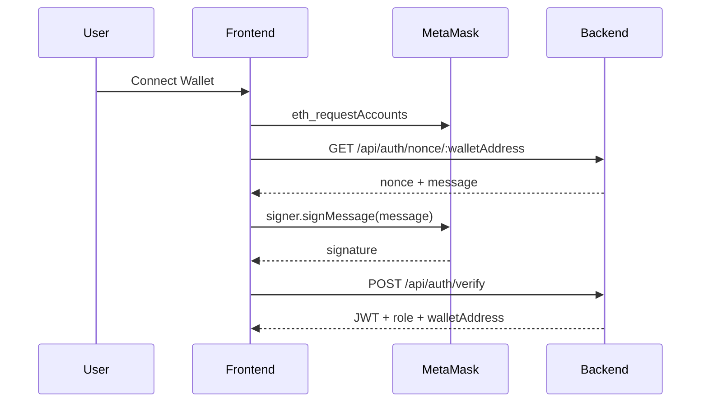
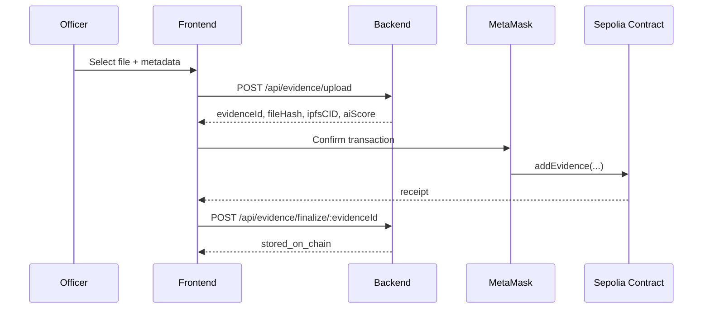

# DEMS Frontend

React 19 + Vite frontend for the Decentralized Evidence Management System.

## Run

```bash
pnpm install
pnpm dev
```

Set environment values in `.env`:

```bash
VITE_API_BASE_URL=http://127.0.0.1:3000/api
VITE_EVIDENCE_CONTRACT_ADDRESS=
VITE_REQUIRED_CHAIN_ID=11155111
```

## Folder Structure

- `src/api` Axios API layer matching backend routes
- `src/auth` wallet/JWT AuthContext
- `src/blockchain` MetaMask, Sepolia, ethers v6 services
- `src/abis` smart-contract interface
- `src/components` shared secure-vault UI
- `src/layouts` public and protected shells
- `src/pages/public` landing, about, features
- `src/pages/auth` wallet login
- `src/pages/citizen` dashboard, vault, details, profile
- `src/pages/officer` dashboard, upload, custody, tracking
- `src/pages/admin` dashboard, approvals, users, audit logs
- `docs/COMPATIBILITY_REPORT.md` actual backend API contract

## Architecture



## Wallet Login Sequence



## Evidence Upload Sequence


